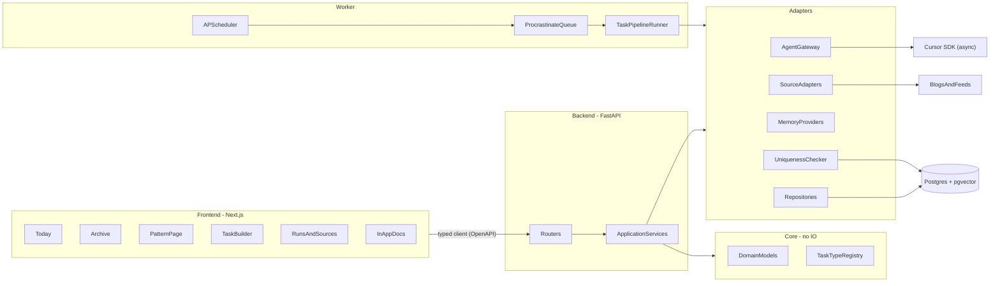
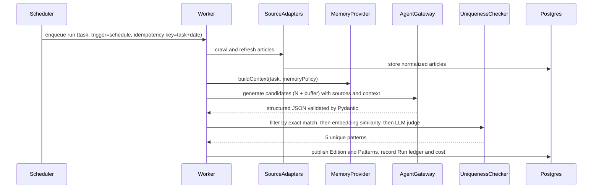

# honest-practice: Phased Build Plan

## Naming

- Product name: **honest-practice** (display name "Honest Practice").
- Repository and folder: `honest-practice/`
- Python package: `honest_practice`
- npm workspace scope: `@honest-practice/*` (for example `@honest-practice/ui` and `@honest-practice/api-client`)
- Docker Compose project and image prefix: `honest-practice`
- Environment variable prefix: `HP_` (for example `HP_DATABASE_URL`). `CURSOR_API_KEY` keeps the name the SDK expects.

## Decisions already made

- Backend: Python 3.12, FastAPI, Pydantic v2, SQLAlchemy 2.0, Alembic, Postgres 16 with pgvector, the `cursor-sdk` async client, APScheduler for schedules, and Procrastinate (a Postgres-backed queue) for jobs.
- Frontend: Next.js (App Router), TypeScript, Tailwind driven by the honest-practice design tokens, and Storybook. The API client is generated from FastAPI's OpenAPI schema.
- Hosting: local first with Docker Compose, plus a documented VPS profile that adds Caddy for HTTPS and single-user authentication.
- Docs: one Markdown source in `docs/`, shown as plain Markdown, as an MkDocs Material site, and inside the app.
- Design: the editorial "study desk" visual concept (a learner's field notebook with daily editions and specimen plates). Light theme by default with a dark "lamp-lit" mode, using the palette, type, and imagery agreed earlier.
- Refinement since the earlier discussion: the backend is **one Python package with strictly enforced internal boundaries** (checked by `import-linter`) instead of many separate packages. This gives the same isolation with less overhead.

## Architecture



## Daily run (the core workflow)



**Key rule (to be recorded as an ADR):** the memory toggle controls *what context the agent sees*. It never weakens the uniqueness guarantee. Uniqueness is always checked against the full history, even when memory is off.

## Manual triggering (applies to every workflow and job)

Everything the scheduler can run, you can also run by hand: built-in tasks, tasks you create, and system jobs. There is no work that is "schedule only".

- **One path for every trigger.** Scheduled, manual (UI), manual (CLI), and API triggers all enqueue the same job through one `TriggerService`. Each run records who or what triggered it (`trigger = schedule | manual_ui | manual_cli | api | retry`).
- **What can be triggered:**
  - any task, from the Tasks list, the task detail page, the Today page ("pull a fresh edition"), or the CLI;
  - any individual system job: crawl one source, crawl all sources, re-embed articles or patterns, rebuild history-summary memory, recover stale runs, run a backup;
  - any past run: re-run it with the same inputs, or resume a failed run from the step where it failed.
- **One-off overrides for a manual run**, which never change the saved task: memory policy (use history or fresh start), number of patterns, sources to include, model, and a free-text focus (for example "graph patterns only").
- **Dry run:** runs the full pipeline and shows the result as a preview without publishing it to the archive. You can then publish or discard it.
- **Safety:**
  - manual runs get their own idempotency key, so a scheduled run on the same day doesn't block them;
  - a per-task concurrency guard stops two runs of the same task colliding;
  - the daily budget cap still applies, with a confirmation prompt if a manual run would exceed it.
- **Job registry:** every system job registers with a key, a description, and a parameter schema. The UI's "Jobs" panel and the CLI list jobs from this registry automatically, so a new job you add can be triggered by hand straight away.

## Repository layout

- `backend/src/honest_practice/core/`: entities, value objects, the `TaskType` protocol, and domain errors. Must not import I/O code.
- `backend/src/honest_practice/agents/`: `AgentGateway`, the prompt registry, and versioned prompts under `prompts/`.
- `backend/src/honest_practice/sources/`: the source adapter protocol plus RSS, sitemap, HTML article, GitHub, and manual URL adapters.
- `backend/src/honest_practice/memory/`: `NoMemory`, `HistorySummaryMemory`, and `VectorRetrievalMemory`.
- `backend/src/honest_practice/uniqueness/`: the three-stage duplicate checker.
- `backend/src/honest_practice/tasks/`: built-in task types (`pattern_edition`, `custom_research`) and the pipeline runner.
- `backend/src/honest_practice/db/`: models, repositories, and `alembic/`.
- `backend/src/honest_practice/api/`: routers, dependencies, auth, and SSE streaming.
- `backend/src/honest_practice/worker/`: scheduler and queue entry points, `TriggerService`, and the job registry.
- `backend/src/honest_practice/cli/`: the `hp` command-line tool (Typer), for example `hp tasks run <task>`, `hp jobs run crawl-source --source <id>`, and `hp runs rerun <run-id>`.
- `frontend/web/`, `frontend/ui/`, `frontend/api-client/`
- `docs/`, `deploy/`, and `.github/workflows/`

## Core extension contract (sketch)

```python
class TaskType(Protocol):
    """A pluggable kind of task. Register it once and the UI, scheduler, and API pick it up."""
    key: ClassVar[str]
    config_model: ClassVar[type[BaseModel]]   # validated user configuration
    output_model: ClassVar[type[BaseModel]]   # validated agent output

    async def run(self, ctx: RunContext, config: BaseModel) -> RunOutcome: ...
```

The `SourceAdapter`, `MemoryProvider`, `Generator`, and `Notifier` interfaces follow the same pattern: a protocol, a registry, and a contract test suite that every implementation must pass.

---

## Phase 0: Foundations and scaffolding

Goal: an empty but production-grade skeleton where every later phase drops in cleanly.

- Monorepo layout, a uv project for the backend, and a pnpm workspace for the frontend.
- Tooling: Ruff, mypy (strict), pytest, import-linter contracts, ESLint, Prettier, TypeScript strict mode, and pre-commit hooks.
- [deploy/docker-compose.yml](deploy/docker-compose.yml) running postgres (pgvector), api, worker, and web, plus `.env.example`.
- One validated settings model at [backend/src/honest_practice/config.py](backend/src/honest_practice/config.py). It is the single source for every environment variable.
- CI in [.github/workflows/ci.yml](.github/workflows/ci.yml): lint, type-check, tests, docs build, and link check.
- Docs skeleton: the full `docs/` tree with stub pages, [mkdocs.yml](mkdocs.yml), and ADR-0001 to ADR-0006 covering the stack, monolith boundaries, Postgres-only queue, OpenAPI client, docs strategy, and the memory versus uniqueness rule.
- Exit: `docker compose up` gives a healthy `/health` endpoint, a blank Next.js page, and a built docs site.

## Phase 1: Domain core and data layer

- Entities:
  - `Task` (type, config, schedule, memory policy, enabled)
  - `Run` (trigger, status, Cursor agent and run IDs, prompt version, model, cost, error kind)
  - `Edition`
  - `Pattern` (catalogue number such as `DSA-0147` or `SD-0093`, kind, slug, structured content, embedding)
  - `Source` and `Article`
  - `PatternSource`
  - `StudyProgress`, `Note`, and `LearningSession`
- Alembic migrations, repositories behind interfaces, and a unit-of-work pattern.
- The pattern content schema is fixed: intuition, recognition signals, template code, complexity, worked problem, a practice ladder, pitfalls, and source footnotes.
- Docs: data model and ERD, domain glossary, pattern taxonomy, and ADRs for the entities.

## Phase 2: Agent gateway (Cursor SDK)

- [backend/src/honest_practice/agents/gateway.py](backend/src/honest_practice/agents/gateway.py) uses one async client per event loop and never mixes sync and async clients.
  - It sets the runtime explicitly (local, with a sandbox working directory), always disposes of agents, and passes no ambient settings.
  - It logs the agent ID and run ID as soon as a run starts.
  - It separates `CursorAgentError` (the run never started) from an error status (the run started and failed).
  - It retries only when the SDK marks an error as retryable, honouring `retry_after`.
- Prompt registry: prompts are versioned files, and every output records the prompt version and model.
- Structured output: the agent must return JSON, which is validated with Pydantic and repaired or retried a limited number of times before being rejected.
- Cost and budget guard: a cap per run and a cap per day, both from settings.
- Docs: Cursor SDK integration guide, prompt catalogue, error taxonomy, and cost controls.

## Phase 3: Sources and research

- The `SourceAdapter` protocol (`discover`, `fetch`, `normalize`) with RSS/Atom, sitemap, HTML article extraction (trafilatura), GitHub (awesome lists and repos), and manual URL adapters.
- A seed source list of curated engineering blogs and DSA resources, editable from the UI later.
- Politeness: robots.txt, rate limits per domain, caching, and content hashing so the same article is never stored twice.
- Article embeddings stored in pgvector for retrieval.
- Docs: how sources work, the guide to adding a source adapter, and the source policy (ethics and licensing).

## Phase 4: Generation pipeline, uniqueness, and memory

- The `pattern_edition` task type. Daily DSA and daily system design are two seeded task configurations of this one type.
- Candidate generation produces N plus a buffer (for example 8), then the uniqueness filter selects 5. If too few survive, a regeneration loop runs, with a cap on attempts.
- `UniquenessChecker`, in three stages:
  1. exact match on the normalized slug;
  2. pgvector cosine similarity against every past pattern of the same kind, with configurable reject and borderline thresholds;
  3. an LLM judge for the borderline band only.
- Memory providers:
  - `none` passes no context;
  - `history_summary` passes compressed titles and topics plus your study progress;
  - `vector_retrieval` passes related past patterns and notes.
- Idempotent runs: scheduled runs use the task plus the date as the idempotency key, so a retried run never publishes twice. Manual runs use their own trigger ID as the key. Every run writes to the run ledger.
- The pipeline is a sequence of named, checkpointed steps (crawl, build context, generate, deduplicate, publish), so a failed run can resume from the failed step and a dry run can stop before publishing.
- Docs: generation workflow sequence diagram, uniqueness algorithm, memory policies, and an evaluation rubric for output quality.

## Phase 5: Scheduler and worker

- APScheduler loads schedules from the `Task` table and hands triggers to `TriggerService`, which enqueues Procrastinate jobs. Manual triggers from the UI, CLI, and API use the same service and queue.
- Job registry for system jobs (crawl one source, crawl all, re-embed, rebuild memory, recover stale runs, backup), each with a parameter schema.
- Manual trigger features: one-off overrides, dry run with publish or discard, re-run, resume from the failed step, a per-task concurrency guard, and a budget confirmation.
- The `hp` CLI covering tasks, jobs, and runs.
- Retries with backoff, a dead-letter state, run cancellation, and recovery of stale runs after a crash or restart.
- Notifier interface with an in-app notification first. Email is an optional later adapter.
- Docs: scheduling workflow, manual triggering guide (UI, CLI, and API, with overrides and dry runs), failure and retry paths, CLI reference, the guide to adding a system job, and worker runbook.

## Phase 6: API

- Routers for:
  - editions (today and by date);
  - patterns (detail, search, filter);
  - archive (calendar data and full-text plus semantic search);
  - tasks (CRUD, validation, and `POST /tasks/{id}/trigger` with optional overrides and a dry-run flag);
  - jobs (`GET /jobs` lists the registry, `POST /jobs/{key}/trigger` runs any system job);
  - runs (list, detail, live status over SSE, re-run, resume, cancel, publish or discard a dry run);
  - sources;
  - study progress and notes.
- Learning sessions stream over SSE. A multi-turn session stores the Cursor agent ID and resumes it on later requests.
- OpenAPI schema generates the TypeScript client into `frontend/api-client/`, and a CI check fails if the generated client is out of date.
- Docs: API reference (generated) and auth model.

## Phase 7: Design system and UI foundation

- Tokens for colour (light and dark), type scale, spacing, radii, rules, and motion, defined in [frontend/ui/tokens/](frontend/ui/tokens/) and shared by Tailwind and the MkDocs theme.
- Fonts: Newsreader, IBM Plex Sans, and IBM Plex Mono.
- Components:
  - masthead;
  - specimen plate;
  - catalogue tag;
  - ruled section;
  - footnote;
  - marginalia panel;
  - memory toggle;
  - plain-language schedule picker;
  - run timeline;
  - calendar heatmap.
  Each component gets a Storybook story and an accessibility check.
- Imagery:
  - a house style for pattern diagrams (SVG, 1.5px ink stroke, one accent colour, hatching);
  - duotone public-domain engraving plates for section headers and empty states;
  - a subtle paper grain texture.
- Docs: design principles, design system, imagery and diagram style guide, accessibility standard, and writing voice.

## Phase 8: Core screens

- Today: the daily edition masthead, 5 DSA and 5 system design plates, and a "pull a fresh edition" button.
- Pattern page: the specimen plate, worked problem, practice ladder, footnoted sources, notes, and study status.
- Archive: calendar heatmap, filters (subject, tag, difficulty, status), search, and any past edition opened exactly as it was published.
- Runs and Sources: run timeline, logs, cost, duplicates skipped, and source management, with re-run, resume, and cancel actions on each run and a "crawl now" action on each source.
- Run now everywhere: every task and every system job has a "Run now" action. It opens a short drawer for one-off overrides (memory, count, sources, model, focus) and a dry-run switch. A Jobs panel lists every registered system job.
- Dry-run preview: the result looks exactly as it would on the Today page, with "Publish" and "Discard" buttons.
- Docs section: renders `docs/` in the app at build time.

## Phase 9: Agentic features

- **Learning assistant** in the marginalia panel, with modes for hint ladder, Socratic questioning, solution review (you paste your code), complexity check, and "quiz me". Memory on or off can be chosen per session.
- **Agentic task builder**: you describe a task in plain language and the agent drafts a `TaskDefinition` covering type, configuration, sources, schedule, and memory policy. You review, edit, and save it. It is validated against the task type's `config_model`.
- **Custom task type** (`custom_research`) for things like "3 concurrency patterns weekly" or "1 SQL pattern daily", reusing the same pipeline and uniqueness machinery.
- Docs: learning session workflow, task builder workflow, and the guide to adding a task type, with a worked example.

## Phase 10: Quality hardening

- Tests:
  - unit tests for the core;
  - contract tests for every adapter type;
  - golden prompt tests with recorded fixtures (no live API calls in CI);
  - integration tests against a test Postgres;
  - Playwright end-to-end tests for Today, Pattern, Archive, Task builder, Run now with overrides, dry run, re-run, and resume.
- An accessibility audit (axe plus manual keyboard and screen reader passes) and a performance budget for page loads.
- Security: no secrets in logs, input validation everywhere, and an SSRF guard on manual URL fetching.
- Docs: testing strategy, code review checklist, coding and commenting standards, and threat model.

## Phase 11: Documentation completion

- Fill every page in the tree:
  - start here;
  - product (vision, personas, journeys, functional and non-functional requirements, scope, roadmap);
  - UX design;
  - architecture (C4 at levels 1 to 4, design patterns used and why);
  - workflows;
  - agents and AI;
  - domain;
  - extending;
  - code quality;
  - operations;
  - reference;
  - security and privacy;
  - CONTRIBUTING, CHANGELOG, and FAQ.
- Generated reference pages: Python API (mkdocstrings), environment variables (from the settings model), database schema (from the models), and the HTTP API (from OpenAPI).
- Vale and markdownlint run in CI, and the PR template requires a docs update for any behaviour change.

## Phase 12: Deployment path

- [deploy/docker-compose.prod.yml](deploy/docker-compose.prod.yml) adds Caddy with automatic HTTPS and single-user authentication (passkey or password with secure sessions), and turns off debug settings.
- Scheduled Postgres backups, a tested restore procedure, log rotation, and a health and uptime check.
- Docs: deployment guide (local and VPS), upgrade procedure, backup and restore runbook, incident runbook, and cost management.

## Standards applied in every phase

- Each phase ends with passing CI, its docs pages written, and any new ADRs recorded.
- Comments:
  - Google-style docstrings on every public Python symbol and TSDoc on exported TypeScript;
  - a README for each module;
  - inline comments only to explain why something non-obvious is done.
- Conventional commits and a generated changelog.