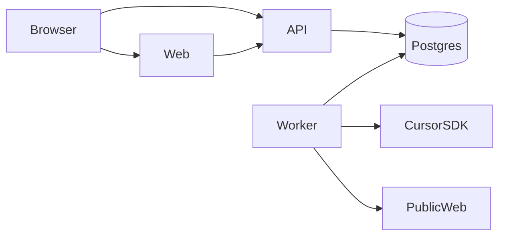

# Architecture

Honest Practice is one deployable system with three processes: a web app, an API, and a worker. They share one Postgres database. The worker is the only process that calls the Cursor SDK and the only process that fetches web pages.

The browser talks to the API directly for health, and later for editions and tasks. The web server does not proxy those calls in Phase 0. That is why `NEXT_PUBLIC_API_URL` is a public URL and why the API has a CORS list.

## Where to go next

- [Module boundaries](module-boundaries.md) for the import rules that keep the Python package from becoming a ball of mud.
- [Decisions](adr/index.md) for the six choices Phase 0 records.
- [C4 model](c4.md), [data model](data-model.md), and [design patterns](design-patterns.md) are outlines until the code they describe exists.

## What is deliberate

The domain code does not know about FastAPI, SQLAlchemy, or the Cursor SDK. Adapters sit behind packages, and `import-linter` fails CI when a forbidden import appears. See [ADR-0002](adr/0002-package-boundaries.md).
